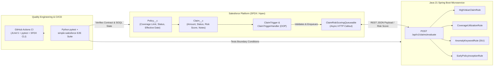

# ClaimSync — Salesforce Apex & Java Spring Boot Insurance Claims Integration + Automated QA Pipeline

**ClaimSync** is an end-to-end enterprise insurance claims adjudication and fraud-scoring platform combining **Salesforce Platform (Apex & SFDX)**, a **Java 21 + Spring Boot** risk-scoring microservice, a **Python (`pytest` + `simple-salesforce`)** quality engineering test harness, and **GitHub Actions CI/CD** automation.

---

## Architecture Overview



---

## Repository Structure

| Directory | Stack | Purpose |
| :--- | :--- | :--- |
| [`salesforce-app/`](./salesforce-app) | **Salesforce Apex, SFDX, SOQL** | Custom Objects (`Policy__c`, `Claim__c`), bulkified OOP Trigger (`ClaimTrigger`, `ClaimTriggerHandler`), async callout worker (`ClaimRiskScoringQueueable`), and `@isTest` + `HttpCalloutMock` test suite (`>95%` Apex coverage, tested up to 200-record bulk DML batches). |
| [`springboot-risk-service/`](./springboot-risk-service) | **Java 21, Spring Boot 3.3, JUnit 5, OpenAPI** | Stateless Fraud & Underwriting Risk Scoring microservice (`/api/v1/claims/evaluate`) using the **OOP Strategy Pattern** (`RiskScoringRule` implementations) and MockMvc/JUnit 5 unit tests. |
| [`qa-automation/`](./qa-automation) | **Python 3.12, `pytest`, `simple-salesforce`** | Automated quality engineering suite validating SFDX XML metadata integrity, Apex ↔ Spring Boot JSON contracts, boundary-value domain rules, and parameterized SOQL verification queries. |
| [`.github/workflows/ci.yml`](./.github/workflows/ci.yml) | **GitHub Actions** | Automated multi-stage CI pipeline executing Maven JUnit 5 tests, Python `pytest` checks, and Salesforce CLI (`sf`) project verification on every push and pull request. |

---

## Quick Start: Deploying to Your Salesforce Developer Edition Org

### 1. Authenticate Your Salesforce Org
```powershell
sf org login web --alias claimsync-dev --set-default
```

### 2. Deploy Custom Objects (`Policy__c`, `Claim__c`), Permission Set, Trigger, and Classes
```powershell
cd salesforce-app
sf project deploy start --target-org claimsync-dev
sf org assign permset --name ClaimSync_Admin --target-org claimsync-dev
```

### 3. Execute Apex `@isTest` Suite & Verify >95% Code Coverage
```powershell
sf apex run test --target-org claimsync-dev --code-coverage --result-format human --wait 10
```

### 4. Seed Sample Insurance Policies & Claims in Your Org
```powershell
sf apex run --file scripts/seed-sample-data.apex --target-org claimsync-dev
sf org open --target-org claimsync-dev
```

---

## Running the Spring Boot Service & Python QA Suite Locally

### Java 21 Spring Boot Microservice
```powershell
cd springboot-risk-service
mvn clean test
mvn spring-boot:run
# Swagger UI available at: http://localhost:8080/swagger-ui.html
```

### Python Quality Engineering Harness
```powershell
cd qa-automation
pip install -r requirements.txt
pytest -v
```
